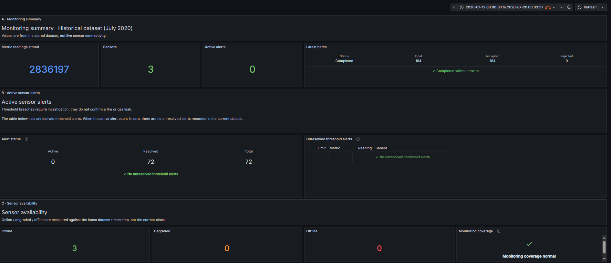

# City Environmental Sensor Monitoring System

An IoT-based environmental monitoring and early-warning prototype for municipal safety operations.

This project implements a containerised environmental monitoring system that processes IoT sensor telemetry, detects threshold breaches, maintains historical records, and provides an interactive Grafana dashboard for monitoring and investigation.

The system combines Python-based data ingestion, MongoDB storage, a FastAPI backend, and Grafana visualisation. It also provides API endpoints for operator actions, including alert acknowledgement, false-positive classification, and site-check requests.

The objective is to support the early identification of potentially hazardous environmental conditions while providing reliable access to historical sensor information.

System Dashboard

### System Dashboard



Figure 1. Grafana dashboard showing historical monitoring statistics, threshold alerts, sensor availability, and ingestion status.

Additional application screenshots, including environmental trends and FastAPI operator-action endpoints, are available in the screenshots directory.

Repository: https://github.com/TumisangF/sensor-monitoring-system

## 1. Project Overview

Municipal facilities may require continuous monitoring of environmental conditions associated with potential fire, smoke, and gas hazards. Sensor networks can produce substantial volumes of telemetry, making it necessary to automate data processing, identify unusual conditions, and present relevant information to responsible personnel.

This project addresses those requirements through a prototype monitoring platform.

### Main objectives

- Ingest environmental telemetry from CSV files.
- Validate sensor readings and handle duplicate or invalid records.
- Store sensor readings and alert information in MongoDB.
- Detect configurable threshold breaches.
- Display environmental trends, sensor status, and alerts in Grafana.
- Provide operator actions for acknowledging alerts, identifying false positives, and requesting site inspections.
- Identify missing or delayed sensor data.
- Support recovery and investigation of ingestion or database interruptions.

**System scope:** The implementation processes historical telemetry. It does not currently connect to live physical sensors, confirm actual fires or gas leaks, notify citizens, or dispatch emergency services.

## 2. System Architecture

The application follows a modular architecture:

```text
                ENVIRONMENTAL SENSOR DATA
                 Historical CSV Dataset
                           |
                           v
                 INGESTION PIPELINE
                 ------------------
                 CSV parsing
                 Data validation
                 Batch processing
                 Duplicate handling
                           |
                           v
                      MONGODB
                 ------------------
                 Sensor readings
                 Threshold alerts
                 Monitoring records
                           |
                           v
                       FASTAPI
                 ------------------
                 Health endpoints
                 Sensor information
                 Alert management
                 Historical trends
                 Operator actions
                           |
                           v
                      GRAFANA
                 ------------------
                 Monitoring overview
                 Sensor availability
                 Environmental trends
                 Threshold alerts
```

### Technology stack

| Component | Technology | Purpose |
|---|---|---|
| Programming language | Python | Data processing and application logic |
| Database | MongoDB 7.0 | Persistent storage |
| Backend | FastAPI | Monitoring and operator-action API |
| Visualisation | Grafana 11.6.11 | Monitoring dashboard |
| Data integration | Grafana Infinity datasource | API-to-dashboard integration |
| Containerisation | Docker Compose | Service orchestration |
| Configuration | JSON and environment variables | Thresholds and deployment settings |
| Testing | Python tests and Bash verification scripts | Functional and reliability checks |

## 3. Dataset

The system uses the Environmental Sensor Telemetry dataset published on Kaggle:

https://www.kaggle.com/datasets/garystafford/environmental-sensor-data-132k

The local dataset contains **405,184 records** collected from three environmental sensor devices.

The CSV contains the following columns:

| Column | Description |
|---|---|
| `ts` | Unix timestamp in seconds |
| `device` | Unique sensor/device identifier |
| `co` | Carbon monoxide sensor reading |
| `humidity` | Humidity reading |
| `light` | Light detection indicator |
| `lpg` | LPG sensor reading |
| `motion` | Motion detection indicator |
| `smoke` | Smoke sensor reading |
| `temp` | Temperature reading |

Example:

```csv
"ts","device","co","humidity","light","lpg","motion","smoke","temp"
"1.5945120943859746E9","b8:27:eb:bf:9d:51","0.004955938648391245","51.0","false","0.00765082227055719","false","0.02041127012241292","22.7"
```

The dataset contains historical observations from July 2020.

**Measurement limitation:** CO, LPG, and smoke values are treated as dataset-specific sensor readings. They are not assumed to represent calibrated concentrations in parts per million (ppm).

### Dataset preparation

Download the dataset from the source above and prepare the CSV using the expected schema.

Place the file at:

```text
data/iot_telemetry_data.csv
```

The dataset is excluded from Git because of its size.

The ingestion service reads CSV files from the mounted `data/` directory.

## 4. Installation and Setup

### Prerequisites

- Docker Desktop or Docker Engine with Docker Compose
- Git
- The environmental telemetry dataset
- Available local ports 27017, 8000, and 3000, unless configured otherwise

### Step 1 — Clone the repository

```bash
git clone https://github.com/TumisangF/sensor-monitoring-system.git
cd sensor-monitoring-system
```

### Step 2 — Configure environment variables

Create a local environment file:

```bash
cp .env.example .env
```

Open `.env` and replace the example passwords with secure values.

The main configuration variables include:

| Variable | Purpose |
|---|---|
| `MONGO_ROOT_USER` | MongoDB administrator username |
| `MONGO_ROOT_PASSWORD` | MongoDB administrator password |
| `MONGO_DB` | Application database |
| `MONGO_PORT` | MongoDB host port |
| `APP_DB_USER` | Application database username |
| `APP_DB_PASSWORD` | Application database password |
| `BATCH_SIZE` | Number of records processed per batch |
| `API_PORT` | FastAPI host port |
| `GRAFANA_ADMIN_USER` | Grafana administrator username |
| `GRAFANA_ADMIN_PASSWORD` | Grafana administrator password |
| `GRAFANA_PORT` | Grafana host port |

The actual `.env` file is excluded from version control.

### Step 3 — Prepare the dataset

Place the CSV file in the project's `data/` directory.

Expected path:

```text
sensor-monitoring-system/data/iot_telemetry_data.csv
```

### Step 4 — Start the application

Run:

```bash
docker compose up -d --build
```

Docker Compose starts the configured services and handles their dependencies.

The ingestion service waits until MongoDB is healthy and database initialisation has completed successfully.

It then processes the CSV dataset in batches and stores the results.

**The ingestion container is a one-shot batch job.** It is expected to exit after completing its work.

### Step 5 — Verify service status

```bash
docker compose ps
```

The API and MongoDB services should report healthy status when their health checks pass.

Grafana should be running.

Check ingestion logs:

```bash
docker compose logs ingestion
```

Check API logs:

```bash
docker compose logs api
```

### Step 6 — Access the application

| Service | Local URL |
|---|---|
| FastAPI | http://localhost:8000 |
| FastAPI interactive documentation | http://localhost:8000/docs |
| Grafana | http://localhost:3000 |
| Sensor monitoring dashboard | http://localhost:3000/d/sensor-monitoring |

Sign in to Grafana using the credentials configured in `.env`.

## 5. Data Ingestion

The ingestion pipeline processes telemetry in batches.

Its responsibilities include:

1. Reading sensor data from the configured directory.
2. Parsing timestamps and environmental measurements.
3. Validating incoming records.
4. Handling invalid or duplicate readings.
5. Storing valid readings in MongoDB.
6. Supporting threshold-based alert generation.
7. Recording processing outcomes for verification.

The default batch size is 500 records, configurable through `BATCH_SIZE`.

The ingestion service uses the threshold configuration located at:

```text
config/thresholds.json
```

### Monitoring ingestion

```bash
docker compose logs ingestion
```

The logs provide evidence of processing progress and ingestion outcomes.

Because the system uses historical CSV data, ingestion occurs as a batch-processing operation rather than a continuous live sensor stream.

## 6. Threshold-Based Alert Detection

The system evaluates environmental readings against configured thresholds.

When a reading satisfies a configured breach condition, the alert engine can create an alert record for investigation.

An alert may include information such as:

- Sensor identifier
- Environmental metric
- Recorded reading
- Configured threshold
- Breach condition
- Device timestamp
- Alert status

### Alert interpretation

A threshold breach indicates a condition that may require investigation.

It does **not** independently establish that a fire, gas leak, or other hazardous incident has occurred.

This distinction is important because sensor readings may be affected by environmental variation, data quality problems, or sensor malfunction.

### Alert management

The backend supports three operator actions:

| Action | Purpose |
|---|---|
| Acknowledge | Record that an operator has reviewed an alert |
| Mark false positive | Classify an alert as not requiring further hazard investigation |
| Request site check | Record a request for physical investigation |

Acknowledging an alert is conceptually different from resolving it.

## 7. API Documentation

The FastAPI application exposes monitoring and operator-action endpoints.

### Monitoring endpoints

| Method | Endpoint | Description |
|---|---|---|
| GET | `/api/health` | Check API health |
| GET | `/api/sensors` | Retrieve sensor information |
| GET | `/api/sensor-status` | Retrieve sensor availability and status |
| GET | `/api/alerts` | Retrieve alert records |
| GET | `/api/alerts/table` | Retrieve unresolved alerts for dashboard display |
| GET | `/api/alerts/summary` | Retrieve alert statistics |
| GET | `/api/trends` | Retrieve historical sensor trends |
| GET | `/api/overview` | Retrieve monitoring overview |

The application also provides a query endpoint at `/api/query`.

### Operator-action endpoints

| Method | Endpoint | Description |
|---|---|---|
| POST | `/api/alerts/{alert_id}/acknowledge` | Acknowledge an alert |
| POST | `/api/alerts/{alert_id}/false-positive` | Mark an alert as a false positive |
| POST | `/api/alerts/{alert_id}/site-check` | Request a site investigation |

The precise request parameters and response schemas can be inspected using the interactive FastAPI documentation:

http://localhost:8000/docs

Operator actions should be tested against dedicated test alerts to avoid modifying historical records unnecessarily.

## 8. System Demonstration — Reproducible API Evidence

The following examples demonstrate verified functionality without requiring a video or live presentation.

All commands assume that the application is running locally.

### Demonstration 1 — API health

**Command**

```bash
curl http://localhost:8000/api/health
```

**Verified output**

```json
{
  "status": "ok"
}
```

**Interpretation:** The API health endpoint reports successful operation.

### Demonstration 2 — Historical alert statistics

**Command**

```bash
curl http://localhost:8000/api/alerts/summary
```

**Verified output**

```json
{
  "total": 72,
  "active": 0,
  "resolved": 72,
  "historical": true
}
```

**Interpretation:** The system can retrieve 72 historical alert records, all of which were resolved at the time of verification.

These records represent threshold alerts, not confirmed hazardous incidents.

### Demonstration 3 — Sensor availability

**Command**

```bash
curl http://localhost:8000/api/sensor-status
```

**Verified availability counts**

```json
{
  "online": 3,
  "degraded": 0,
  "offline": 0
}
```

These counts are extracted from the `counts` field of the full response.

The response also includes:

- Sensor identifiers
- Last recorded timestamps
- Latest environmental readings
- Alert counts
- Availability details
- Historical-data warning

**Interpretation:** All three sensors were classified as online relative to the most recent stored timestamp.

This is a historical availability assessment, not confirmation of live device connectivity.

### Demonstration 4 — Unresolved alerts

**Command**

```bash
curl http://localhost:8000/api/alerts/table
```

The endpoint supplies the unresolved-alert table displayed in Grafana.

The table presents relevant fields such as sensor identifier, environmental metric, reading, and threshold.

When no unresolved alerts exist, the dashboard displays an appropriate no-active-alerts message.

### Demonstration 5 — Operator actions

The system implements API endpoints for the following workflow:

```text
Threshold breach detected
           |
           v
     Alert recorded
           |
           v
    Operator reviews
           |
           +----> Acknowledge alert
           |
           +----> Mark false positive
           |
           +----> Request site check
```

The actions are available through:

```text
POST /api/alerts/{alert_id}/acknowledge
POST /api/alerts/{alert_id}/false-positive
POST /api/alerts/{alert_id}/site-check
```

To reproduce these actions, create or identify a dedicated test alert and use the interactive API documentation at `/docs` to supply the required parameters.

The actions should not be treated as proof of physical inspection or emergency response.

## 9. Grafana Monitoring Dashboard

The system includes a provisioned Grafana dashboard that retrieves monitoring information through the FastAPI backend using the Infinity datasource.

The dashboard provides views of:

- Environmental sensor readings
- Historical measurement trends
- Sensor availability
- Threshold alerts
- Unresolved alert information
- Monitoring and processing status

### Dashboard access

```text
http://localhost:3000/d/sensor-monitoring
```

### Unresolved threshold alerts

The unresolved-alerts table displays active records requiring attention.

When no unresolved alerts are present, the dashboard provides a visual confirmation rather than displaying an unexplained empty table.

### Historical-data interpretation

The sensor-status API calculates availability relative to the latest stored reading.

This distinction prevents historical observations from being presented as evidence of current physical sensor connectivity.


## 10. Reliability and Fault Handling

The system includes mechanisms intended to improve reliability and make abnormal conditions visible.

### Data validation

Incoming readings are checked before storage. Invalid readings can be rejected rather than silently accepted.

### Duplicate handling

The ingestion pipeline includes duplicate-handling logic to reduce repeated records during processing or recovery.

### Sensor availability

The monitoring API supports three availability states:

| State | Interpretation |
|---|---|
| Online | Sensor readings satisfy the configured recency criteria |
| Degraded | Sensor reporting or data quality indicates a partial problem |
| Offline | Sensor readings are missing beyond the configured availability criteria |

For the historical dataset, recency is evaluated relative to the newest stored reading.

### Processing and database interruptions

The project includes fault-handling and recovery logic intended to address ingestion interruptions and database availability problems.

### Verification resources

The repository contains verification scripts for project milestones:

```text
scripts/verify_milestone0.sh
scripts/verify_milestone1.sh
scripts/verify_milestone2.sh
scripts/verify_milestone3.sh
scripts/verify_milestone3_remaining_fixed.sh
scripts/verify_milestone5.sh
scripts/verify_milestone6.sh
scripts/verify_milestone7.sh
```

Automated test files include:

```text
tests/test_alert_engine.py
tests/test_api_faults.py
tests/test_ingestion_faults.py
tests/test_recovery_m8.py
```

### Verification status

During final local verification:

- MongoDB reported healthy status.
- FastAPI reported healthy status.
- Grafana was running and its dashboard displayed correctly.
- The API health endpoint returned a successful response.
- Historical alert statistics were accessible.
- Sensor availability information was accessible.

A standalone pytest execution was attempted, but test collection encountered Python module import-path errors. Therefore, the full automated test suite is not claimed to have passed in the final verification session.

## 11. Stakeholders and Operational Workflows

The system is designed around municipal monitoring responsibilities.

| Stakeholder | Responsibilities |
|---|---|
| Operator | Review alerts, acknowledge alerts, classify false positives, and request site checks |
| Supervisor | Review alert information and coordinate follow-up activities |
| Maintenance personnel | Investigate reported site conditions and communicate findings |
| IT administrator | Monitor system health, ingestion, sensor availability, and configuration |
| City safety coordinator | Review environmental monitoring information and support safety oversight |

The implemented API directly supports operator alert actions.

The broader stakeholder responsibilities describe the intended operational workflow. They should not be interpreted as evidence of a fully implemented role-based access-control system, maintenance dispatch platform, or incident-management application.

## 12. Project Directory Structure

```text
sensor-monitoring-system/
|
├── alerts/
│   ├── engine.py
│   └── run.py
|
├── api/
│   ├── Dockerfile
│   ├── main.py
│   ├── milestone5.py
│   └── requirements.txt
|
├── config/
│   └── thresholds.json
|
├── data/
│   └── iot_telemetry_data.csv  (local, excluded from Git)
|
├── docs/
│   └── data-model.md
|
├── grafana/
│   ├── backups/
│   └── provisioning/
│       ├── dashboards/
│       │   ├── dashboards.yml
│       │   └── sensor-monitoring.json
│       └── datasources/
│           └── infinity.yml
|
├── ingestion/
│   ├── Dockerfile
│   ├── main.py
│   ├── pipeline.py
│   ├── requirements.txt
│   └── thresholds.py
|
├── mongo/
│   └── init-db.js
|
├── scripts/
│   └── verify_milestone*.sh
|
├── tests/
│   ├── fixtures/
│   ├── test_alert_engine.py
│   ├── test_api_faults.py
│   ├── test_ingestion_faults.py
│   └── test_recovery_m8.py
|
├── .env.example
├── .gitignore
├── .gitattributes
├── docker-compose.yml
└── README.md
```

## 13. Common Commands

Check container status:

```bash
docker compose ps
```

View ingestion logs:

```bash
docker compose logs ingestion
```

View API logs:

```bash
docker compose logs api
```

View MongoDB logs:

```bash
docker compose logs mongodb
```

Stop the application while preserving persistent volumes:

```bash
docker compose down
```

Restart services:

```bash
docker compose up -d
```

**Data preservation:** Avoid using `docker compose down -v` unless deliberately resetting the environment, because it removes the project's named Docker volumes and can erase stored database and Grafana data.

## 14. System Limitations

The implementation has several important limitations:

1. **Historical rather than live telemetry:** The system processes archived sensor measurements instead of continuously receiving readings from physical IoT devices.

2. **Threshold-based detection:** Alerts are generated from configured conditions and do not independently establish the presence of an actual fire or gas leak.

3. **Sensor calibration:** The dataset does not provide a sufficient basis to interpret all gas-related readings as calibrated physical concentrations.

4. **Operational response:** The system records operator actions but does not automatically dispatch maintenance personnel or emergency services.

5. **Deployment scope:** The current implementation is an academic prototype rather than a certified safety-critical monitoring solution.

6. **Testing scope:** Although verification scripts and automated tests are included, the complete test suite was not successfully executed during the final local verification session.

## 15. Future Improvements

Potential extensions include:

- Integration with live physical IoT devices.
- Real-time telemetry ingestion using MQTT or similar messaging protocols.
- Role-based authentication and authorisation.
- Automated notification and escalation workflows.
- Maintenance task tracking and incident follow-up.
- Sensor calibration and improved threshold configuration.
- Automated deployment and continuous integration testing.
- Long-term reliability monitoring and performance evaluation.

## 16. Conclusion

The City Environmental Sensor Monitoring System demonstrates how a containerised data-engineering architecture can support environmental monitoring, historical analysis, threshold-based alerts, and operator response workflows.

By integrating batch ingestion, MongoDB, FastAPI, and Grafana, the project provides a practical prototype for collecting and processing sensor data, identifying conditions that require investigation, and presenting relevant information to municipal monitoring personnel.

The implementation also addresses data quality, sensor availability, and recovery considerations, providing a foundation for future real-time IoT monitoring and municipal safety applications.

---

**Project type:** Academic IoT and Data Engineering Project

**Author:** Tumisang Fokase

**Repository:** https://github.com/TumisangF/sensor-monitoring-system
